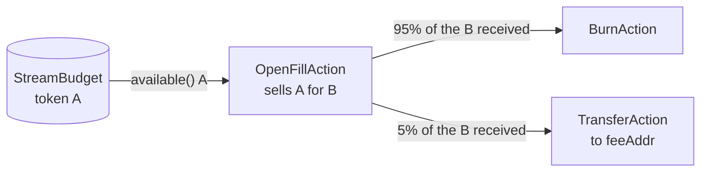
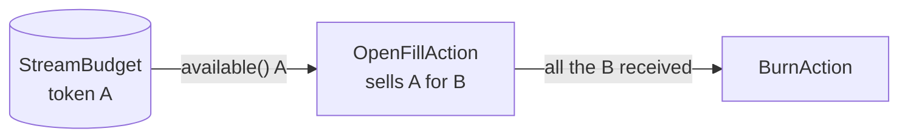
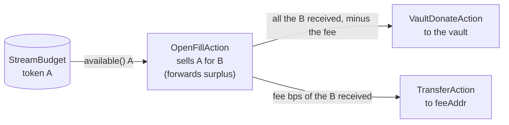
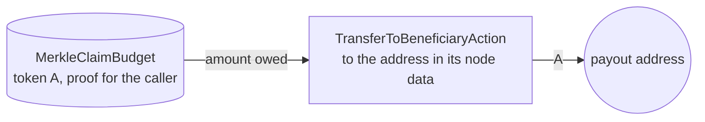
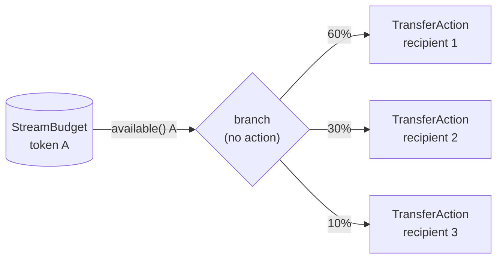
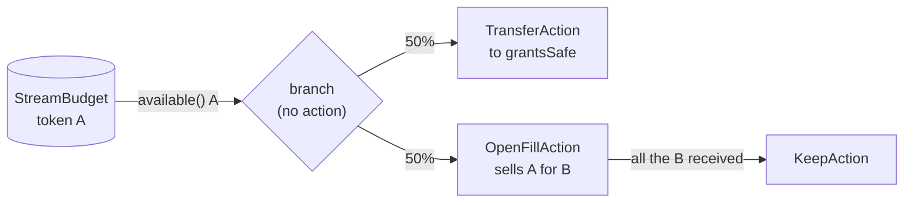
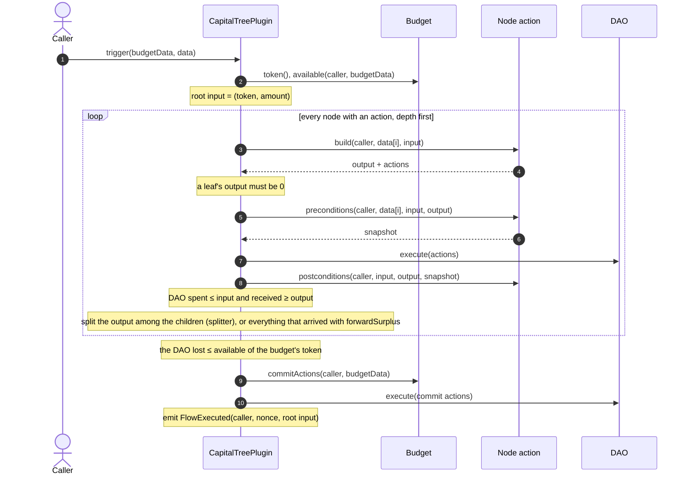
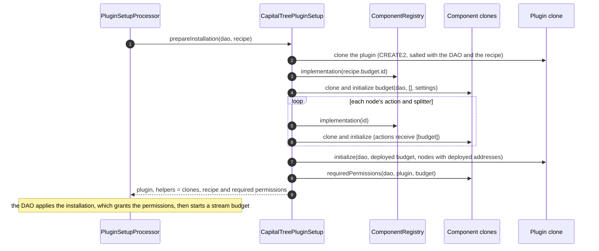

# Capital Tree


Aragon OSx plugin that runs one treasury flow per install: a **budget** feeding a **tree of
actions**. Every node passes its output to its children, split by a splitter (fixed weights or
custom shares) when there are several, and every branch ends in a leaf that consumes what it
receives (transfer, burn, keep, donate). Each node runs in its own `dao.execute`, followed by
balance checks, so a node can only ever spend what the budget released or what its parent really
produced.



Examples: sell token A in a Dutch auction and burn 95% of the proceeds, paying 5% as a fee; buy a
token back and donate it to a vault's holders; let accounts claim cumulative Merkle allocations,
optionally swapped before they're paid; pay a payroll from a stream. Any ERC20 works; native ETH
isn't supported.

Each component is documented in [`docs/components.md`](docs/components.md). To build and run flows on
a local fork, use the [playground](playground/README.md). To install one on a DAO, see
[Install a flow](#install-a-flow).

## Example flows

`script/Recipes.sol` builds five flows. The buyback is the diagram at the top. The other four:

**Buy and burn**: the buyback without a fee, burning everything the swap brings in.



**Buyback and donate**: the buyback, but the proceeds go to a vault's holders. A fee in basis points
goes to a fee recipient, and the rest is donated to the vault, which raises its assets without
minting shares. The OpenFill forwards its surplus, so the fee and the donation split everything the
filler sent. [`docs/avkat-buyback.md`](docs/avkat-buyback.md) walks through the avKAT version.



**Merkle claim**: an account claims what it's owed and gets paid at the address it names in the
leaf's node data.



**Payroll**: a stream split among fixed recipients by a branch with no action.



**Grants and an auction** (no recipe): a branch with no action splits a stream between a grants
transfer and an auction, so the auction's offer grows at half the stream's rate, up to half the
stream's cap. Grants are paid only when someone fills the auction, and the stream then restarts
from zero for both. Changing the auction's demand restarts it too, so the grants lose what accrued
since the last fill (it stays in the DAO).



## How it works

| Term | Meaning |
|---|---|
| **Budget** | How much of one token the flow spends in this trigger. Read once at the start of a trigger (and brought into the DAO first when its tokens sit elsewhere), committed once at the end. |
| **Node** | One step of the tree: an action, its children, the splitter that divides its output among them, whether it may be skipped when it receives nothing, and whether its children get everything that arrived instead of the declared output (`forwardSurplus`). Node 0 is the root and receives the budget. |
| **Action** | A contract that plans what a node does. It never moves funds itself: it returns DAO actions, which the plugin executes through the DAO. |
| **Branch** | A node without an action and with 2+ children. It splits its input among them unchanged. |
| **Leaf** | A node without children. Its action consumes its whole input and outputs nothing. |
| **Splitter** | A contract that divides a branch's output among its children when the flow runs: fixed weights (`WeightSplitter`) or shares computed at run time. It only returns amounts: the children stay nodes of the tree. |

Amounts move down the tree as one struct:

```solidity
struct Asset { IERC20 token; uint256 amount; }
```

A node's input is the asset it receives: the budget at the root, a share of its parent's output
elsewhere. It spends all of it. Its output is the asset its action declares for its children: the
least the action accepts, zero for a leaf. The children get that output, or everything that arrived
on a node marked `forwardSurplus`. The node's splitter divides it, and `NodeExecuted` emits the input,
what the children got and the surplus: what arrived above the declared output, forwarded or not.
A leaf reports no surplus, and neither does a node whose output the plugin doesn't measure (another
token, none declared, no forwarding).

### One trigger, step by step

`trigger(bytes budgetData, bytes[] nodeData)` passes `budgetData` to the budget (a Merkle claim's
proof; empty for the other budgets) and takes either no node data or one entry per node. The budget
and each action receive their own data and the caller's address.



Any failure reverts the whole trigger: a flow never runs halfway. Every trigger counts up a nonce,
so its execution IDs (in the DAO's `Executed`, `NodeExecuted` and `BudgetCommitted`) differ from
another trigger's, even in the same block. Within a trigger, each `dao.execute` has its own index:
i for node i, `nodes.length` for the commit. The errors about a DAO action (`MissingFunctionSelector`,
`ActionTargetsDao`, `ActionTargetsPlugin`) report that same index. A run that finishes emits
`FlowExecuted(caller, nonce, input)` last, after the commit: `input` is what the budget gave the
root, not what the flow spent.

An execution ID isn't a hash: it packs the plugin's address (20 bytes) and the trigger's nonce (8),
which identify the run, then the execution index (4). Trigger 5's node 1, for example, is
`0x<plugin>` `0000000000000005` `00000001`. Which action is which is its position in the DAO's
`Executed` event.

### What the plugin enforces

The plugin only enforces limits that hold for any action. Whether a result is acceptable (a few wei
short, a cap on the surplus, a recipient really paid) is up to each action's postconditions.

When a node runs:

1. After its `dao.execute`, the DAO lost at most the node's input of the input token: a node never spends more than it was given (`UnexpectedBalance`).
2. At least the output the action declared arrived. With one token only the net change is visible: the DAO lost at most input − output. An action that accepts less than it asked for declares that lower amount, so its children only spend what really arrived. They get the declared output; anything above it stays in the DAO, unless the node is marked `forwardSurplus`.
3. A leaf outputs nothing (`OutputWithoutChildren`).
4. Actions can't target the DAO or the plugin. Preconditions and postconditions are views, called read-only.
5. A splitter returns one amount per child, adding up to the output it divides.
6. A node that receives nothing (a weight that rounds down, a splitter's 0, a parent that produced nothing) reverts, unless it's marked `skipWhenEmpty`: then it and everything below it are skipped.
7. A node marked `forwardSurplus` gives its children everything that arrived: the output token's increase with two tokens, its input plus the net change with one.

Over the whole trigger, the DAO lost at most `available` of the budget's token (`BudgetExceeded`).

When the flow is set (`initialize` or `setFlow`, DAO only):

1. At least 1 node; every child comes after its parent, has exactly one parent, and is reachable from node 0. There's no fixed cap (see below).
2. A node without an action has at least 2 children.
3. A node with 2+ children has a splitter made for that many children, or for any (`childCount()` returns 0); other nodes have none (`InvalidSplitter`). Whether the splitter returns one amount per child is checked at trigger (`InvalidSplit`).
4. An action bound to a budget (OpenFill) must be bound to the flow's budget. It may sit anywhere.
5. The budget, every action and every splitter are bound to this plugin's DAO (`ForeignComponent`).
6. The root can't be marked `skipWhenEmpty`: a trigger with nothing to do reverts.
7. Only a node with an action and children can be marked `forwardSurplus` (`InvalidForwardSurplus`).

Gas and the EVM's call stack bound a flow instead, and `setFlow` checks neither: a flow past them
saves, then every trigger reverts. Measured on a first payout:

- Size: a root splitting into transfer leaves fits 215 leaves under 16M gas (15.9M), and about 225
  under the 2^24 transaction cap (EIP-7825). Each transfer leaf adds about 75k gas. Setting a flow
  that size costs about 10M gas.
- Depth: the tree is walked recursively. A straight chain runs up to 69 nodes deep; at 70 the
  trigger reverts with a stack overflow.

## Components

Every component is a clone bound to one DAO. Each has its own doc, linked below, with how it
behaves, its calls and its caveats; its settings and dependencies are in
`metadata/components/<Name>.json`.

| Component                                                                       | Kind     | Does                                                                            |
| ------------------------------------------------------------------------------- | -------- | ------------------------------------------------------------------------------- |
| [`StreamBudget`](docs/components.md#streambudget)                               | Budget   | Grows at a fixed rate up to what the DAO holds and an optional cap; never jumps |
| [`BalanceBudget`](docs/components.md#balancebudget)                             | Budget   | The DAO's whole balance of a token                                              |
| [`MerkleClaimBudget`](docs/components.md#merkleclaimbudget)                     | Budget   | What the caller is owed under a cumulative Merkle root                          |
| [`OpenFillAction`](docs/components.md#openfillaction)                           | Action   | Sells its input for a flat demand: a Dutch auction when a stream feeds it       |
| [`TransferAction`](docs/components.md#transferaction)                           | Leaf     | Sends its input to a fixed recipient                                            |
| [`TransferToBeneficiaryAction`](docs/components.md#transfertobeneficiaryaction) | Leaf     | Sends its input to an address the caller picks                                  |
| [`BurnAction`](docs/components.md#burnaction)                                   | Leaf     | Burns its input                                                                 |
| [`KeepAction`](docs/components.md#keepaction)                                   | Leaf     | Leaves its input in the DAO                                                     |
| [`VaultDonateAction`](docs/components.md#vaultdonateaction)                     | Leaf     | Donates its input to a vault's holders                                          |
| [`WeightSplitter`](docs/components.md#weightsplitter)                           | Splitter | Splits a branch's output by fixed weights                                       |

### Budgets

A budget implements `IBudget`: `token()`; `available(caller, data)`, the root's input; and
`commitActions(caller, data)`, the DAO actions that record the spend after the whole tree ran.

### Actions

Every action implements `INodeAction`, and the plugin calls all of its hooks on every node, so an
action's safety checks can't be skipped. The hooks run in the order of the table.

| Hook                                              | Returns                                                                                                                               |
| ------------------------------------------------- | ------------------------------------------------------------------------------------------------------------------------------------- |
| `budget()`                                        | The budget the action is bound to, or `address(0)` if it works with any input                                                         |
| `build(caller, data, input)`                      | The output (the least the action accepts) and the DAO actions that do the work                                                        |
| `preconditions(caller, data, input, output)`      | A snapshot of what the check compares against (a balance before the work); reverts to block it                                        |
| `postconditions(caller, input, output, snapshot)` | Nothing; reverts when the work went wrong by the action's own standard. Runs right after the work, before the plugin's balance checks |

Actions extend `BaseAction`, which defaults to no budget and empty preconditions and
postconditions, so an action only writes `build` and the hooks it uses. Leaves extend `LeafAction`:
they spend their whole input and output nothing.

### Splitters

Every branch divides its output with a splitter. `WeightSplitter` gives fixed weights; other
splitters can compute shares that depend on the run: a cap for the first child, a top-up to a target
balance, shares that change over time.

```solidity
interface ISplitter {
    function split(address caller, Asset calldata output, uint256 childCount)
        external view returns (uint256[] memory amounts);

    function childCount() external view returns (uint256);
}
```

- **Amounts only:** one per child, in the order of the node's children. A splitter can't pick
  other nodes, so the tree's shape stays what `setFlow` checked.
- **Child count:** `childCount()` is how many children the splitter is made for, or 0 for any.
  `setFlow` rejects a branch with another number of children (`InvalidSplitter`).
- **Checked by the plugin:** the amounts must add up to `output.amount`: the node's declared output,
  or everything that arrived on a node marked `forwardSurplus` (`InvalidSplit`).
- **Empty shares:** a child that gets 0 reverts the trigger, unless it's marked `skipWhenEmpty`:
  then it and everything below it are skipped.
- **View only:** a split changes no state.
- **Setters:** a splitter with its own setters gives its shares to whoever the recipe grants that
  permission.

## Installation

A recipe declares one budget and a tree. Each node declares its own action and splitter (registry
ID and ABI-encoded settings, as its metadata file lists them) and its children, by node index. Each
declaration deploys a fresh clone: identical declarations never share state. ID zero means no action
or splitter, and an absent declaration must have empty settings and permissions.

Permissions sit beside the contract they target as `(who, permissionId)` pairs. Recipients are
actual addresses; `pluginPermissions` targets the plugin. A recipe only grants who governs the
flow. What each component needs to work, it names itself through
`IComponent.requiredPermissions(dao, plugin, budget)`, and the setup grants that as declared: it
trusts the registry's components. For example:

```text
budget: StreamBudget(settings)
  permissions: manager → SET_SETTINGS
nodes:
  0: OpenFill(settings), children [1]
     permissions: manager → SET_SETTINGS
  1: Burn()
pluginPermissions: anyone → TRIGGER, guardian → PAUSE
```

On top of these, the stream requires CHECKPOINT on itself for the DAO, which commits it, and OpenFill
requires CHECKPOINT on the stream for itself, to restart it when the demand changes. A Merkle budget
requires RECORD_CLAIM on itself for the DAO.

The setup deploys the budget first, then each node's action and splitter. Every clone is initialized
through `IComponent.initialize(dao, deps, settings)`. Actions receive `[flowBudget]`; actions that
have no use for it ignore that argument. Budgets and splitters receive `[]`. Recipes cannot choose
another initializer, an arbitrary dependency, or an existing action/splitter address. A newly
registered implementation can be used without changing the setup if it follows these interfaces.
Components extend `BaseComponent`: it locks the implementation so only clones can be initialized,
and declares no required permissions unless the component overrides `requiredPermissions`.



Every component is a fresh clone bound to the installing DAO. The setup returns Aragon's flat
`helpers` array in deployment order: budget first, then each node's action and splitter, skipping
absent declarations. Recipe authors do not maintain helper indexes.

### Clone addresses

Clone addresses are CREATE2 addresses salted with the DAO, the recipe and how many times that DAO
has prepared that recipe. The plugin address in a proposal therefore pins the recipe: someone who
prepares a different recipe first, to front-run the proposal, gets a different address instead of
the one the proposal names. Voters can check a proposal's plugin against the published recipe with
the setup's `pluginAddress(dao, abi.encode(recipe), index)`, where `index` is 0 unless that DAO
prepared the same recipe before.

### The install proposal

Preparing is permissionless and installs nothing. The DAO installs the flow by executing these
actions in one proposal, which `script/Install.s.sol` prints:

1. Grant `ROOT_PERMISSION_ID` on the DAO to the PluginSetupProcessor.
2. `PluginSetupProcessor.applyInstallation(dao, ...)`, which grants the recipe's permissions and the
   ones the components require.
3. Revoke that `ROOT_PERMISSION_ID`.
4. When the budget is a `StreamBudget`, `writeCheckpoint()` on it, which starts the stream (see
   [StreamBudget: Start](docs/components.md#start)).

Only the DAO itself can apply the installation.

### Uninstalling

Uninstallation takes `abi.encode(originalPermissions)`: the complete concrete
`PermissionLib.MultiTargetPermission[]` returned at preparation (also emitted by the processor),
including EXECUTE and CONFIGURE. Setup verifies its stored hash and returns the same entries with
operation Revoke. It does not reconstruct permissions from the recipe or the current tree.

## Develop

With Foundry and `just` installed:

```shell
just init sepolia
forge build
just test
```

`just init <network>` fetches the pinned submodules, creates `.env` from
[`.env.example`](.env.example) if needed, and selects the network. Run `just` to list the
commands provided by [`just-foundry`](https://github.com/aragon/just-foundry). Plain
`forge build` and `forge test` still work without selecting a network.

`just switch <network>` changes the active network. Its RPC, chain and OSx addresses come from
`lib/just-foundry/networks/`; `just switch <network> override` creates an editable local
`.env.<network>` copy. Local `.env` files and generated logs are ignored by Git.

Secrets can be set in `.env` or managed with the optional [`vars`](https://github.com/vars-cli/vars)
CLI (`just install-vars`). [`.vars.yaml`](.vars.yaml) lists the keys and network profiles;
`just-foundry` resolves the profile matching the selected network automatically. Stored values
take priority over `.env`. The Sepolia profile uses `dev/DEPLOYER_KEY`, and the Mainnet and
Sepolia profiles use their respective `<network>/RPC_URL` entries. Other keys use the root
store entries. Configure these with `vars set <key-or-scoped-key>`; secret values belong in
the store or `.env`, never in the manifest.

See the [`vars` documentation](https://github.com/vars-cli/vars#readme) for CLI usage and the
[just-foundry secrets guide](lib/just-foundry/README.md#secrets) for setup and network profiles.

Never set `via_ir = true`; fix stack-too-deep errors by restructuring the code.

`lib/ens-contracts` is only there so Aragon's framework contracts compile. The installation test
deploys Aragon's plugin repo registry, factory and PluginSetupProcessor locally, without ENS.

## Deploy

Once per network:

1. Run `just init <network>` and configure `.env` or your `vars` store. Set `DEPLOYER_KEY` and
   `ETHERSCAN_API_KEY` for deployment and verification, plus any address overrides below.
2. Upload `metadata/release.json`, `metadata/build.json` and every file in `metadata/components/`
   to IPFS (any pinning service).
3. Put each `ipfs://...` link in `metadata/uris.json`: `release`, `build`, and each component's
   name under `components`. The script refuses to run while a link is empty, because registry
   entries and plugin repo versions can't be changed later.
4. Simulate, then deploy:

```shell
just predeploy
just deploy
```

`just predeploy` simulates `script/Deploy.s.sol:Deploy` without broadcasting. `just deploy` runs
the unit tests, broadcasts the deployment, verifies contracts and writes a log under `logs/`.

| Variable                      | Meaning                                                                |
| ----------------------------- | ---------------------------------------------------------------------- |
| `MANAGEMENT_DAO_ADDRESS`      | Maintains the component registry; supplied by the selected network     |
| `PLUGIN_REPO_FACTORY_ADDRESS` | Aragon's factory; supplied by the selected network                     |
| `PLUGIN_REPO_SUBDOMAIN`       | Optional: the name under `plugin.dao.eth`, `capital-tree` by default   |
| `PLUGIN_REPO_MAINTAINER`      | Optional: who can publish later versions, the managing DAO by default  |
| `DEPLOYER_KEY`                | Required signing key for both deployment and installation preparation |

Override network addresses in `.env` or an editable `.env.<network>` using the same variable names.

## Install a flow

1. Copy an example from `installs/` (`buy-and-burn`, `buyback`, `buyback-and-donate`,
   `merkle-claim`, `payroll`) and fill in the DAO, the manager, the guardian, the tokens and the
   amounts (in the token's smallest unit). The manager changes the components' settings; the
   guardian pauses and unpauses the flow. They can be the same address.
2. Select the network with `just switch <network>`. Set `INSTALL_CONFIG=installs/<yours>.json`
   and `PLUGIN_REPO=0x...` in `.env`, and configure `DEPLOYER_KEY` in `.env` or `vars`.
   `PLUGIN_SETUP_PROCESSOR_ADDRESS` comes from the selected network; override it using the same name.
3. Simulate, then broadcast the preparation:

```shell
just dry-run script/Install.s.sol:Install
just run script/Install.s.sol:Install
```

4. Put the actions printed by the broadcast run in a DAO proposal. Once it executes, the
   flow is live: fillers can call `trigger()`, the manager can tune it and the guardian can pause it.
