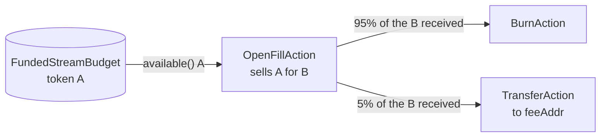
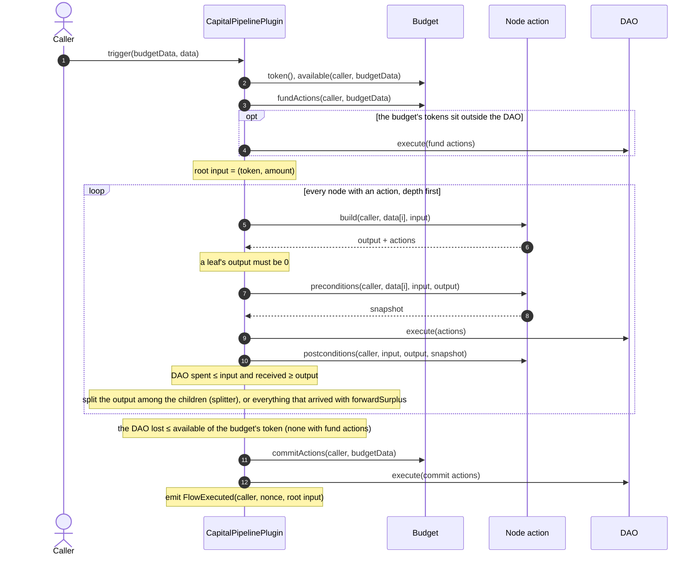
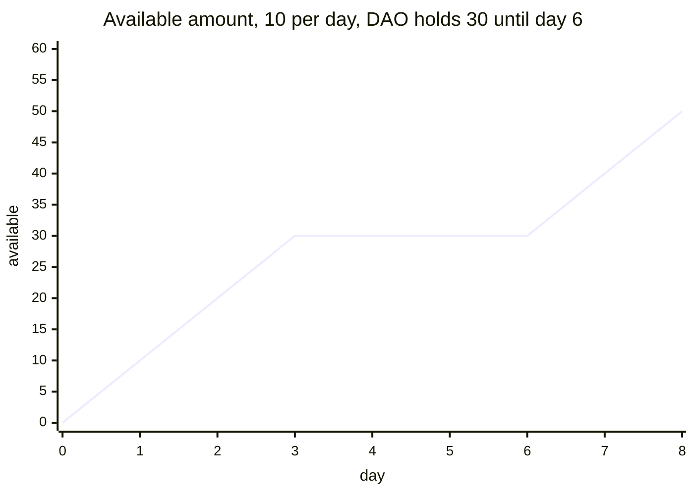
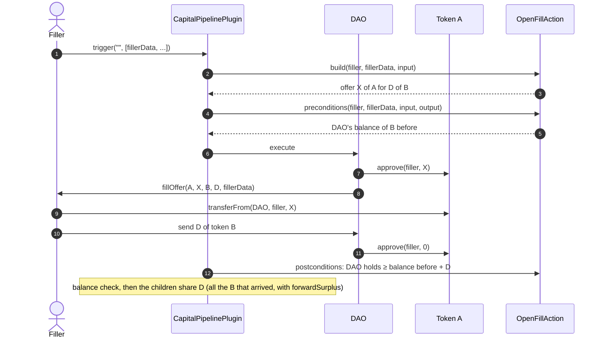
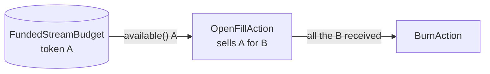
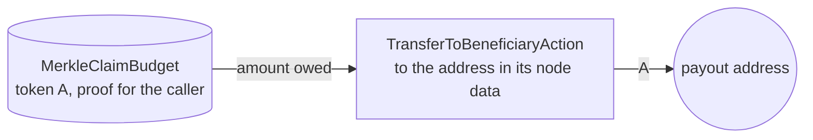
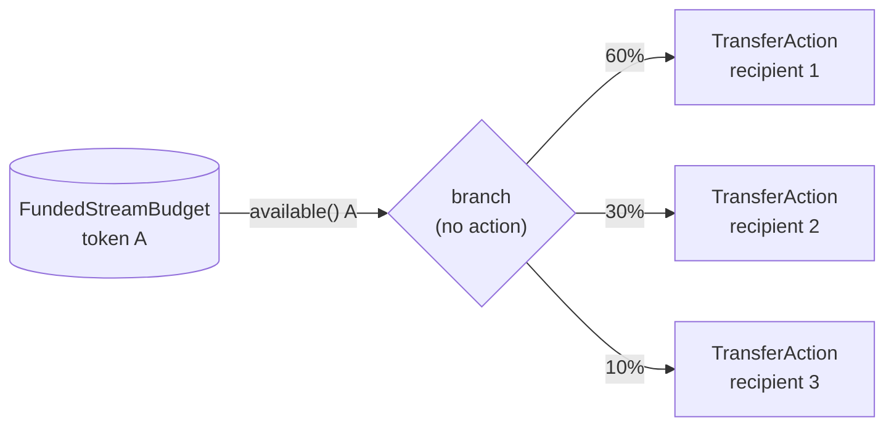
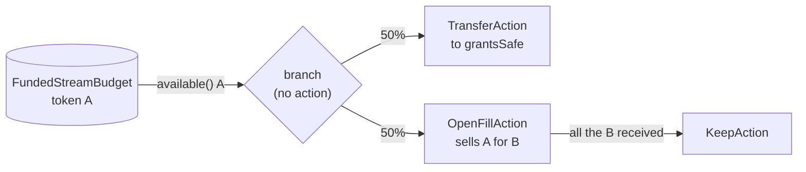
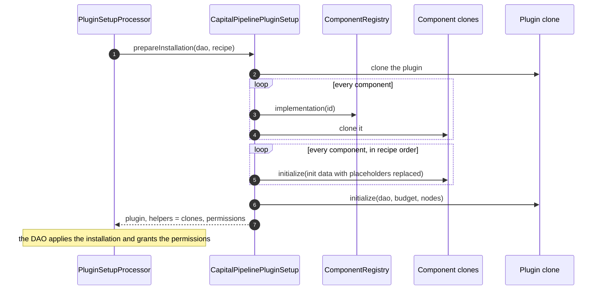
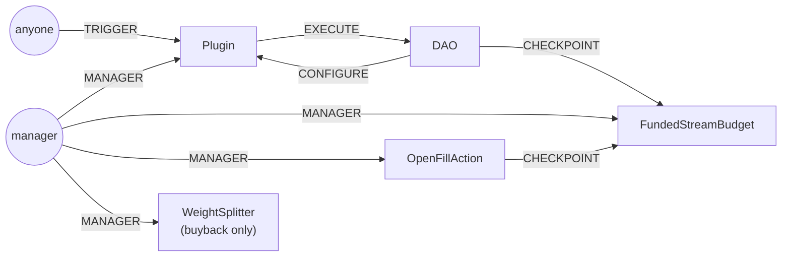

# Capital Tree


Aragon OSx plugin that runs one treasury flow per install: a **budget** feeding a **tree of
actions**. Every node passes its output to its children, split by a splitter (fixed weights or
custom shares) when there are several, and every branch ends in a leaf that consumes what it receives (transfer, burn, keep).
Each node runs in its own `dao.execute`, followed by balance checks, so a node can only ever spend
what the budget released or what its parent really produced.



Examples: sell token A in a Dutch auction and burn 95% of the proceeds, paying 5% as a fee; let
accounts claim cumulative Merkle allocations, optionally swapped before they're paid; pay a
payroll from a stream. Any ERC20 works; native ETH isn't supported.

Design: [`docs/plans/2026-11-04-capital-pipeline-design.md`](docs/plans/2026-11-04-capital-pipeline-design.md)

## How it works

| Term | Meaning |
|---|---|
| **Budget** | How much of one token the flow spends in this trigger. Read once at the start of a trigger (and brought into the DAO first when its tokens sit elsewhere), committed once at the end. |
| **Node** | One step of the tree: an action, its children, the splitter that divides its output among them, whether it may be skipped when it receives nothing, and whether its children get everything that arrived instead of the declared output (`forwardSurplus`). Node 0 is the root and receives the budget. |
| **Action** | A contract that plans what a node does. It never moves funds itself: it returns DAO actions, which the plugin executes through the DAO. |
| **Branch** | A node without an action and with 2+ children. It splits its input among them unchanged. |
| **Leaf** | A node without children. Its action consumes its whole input and outputs nothing. |
| **Splitter** | A contract that divides a branch's output among its children when the flow runs: fixed weights (`WeightSplitter`) or shares computed at run time. It only returns amounts: the children stay nodes of the tree. |

Amounts move down the tree as one struct:

```solidity
struct Asset { IERC20 token; uint256 amount; }
```

A node's input is the asset it receives: the budget at the root, a share of its parent's output
elsewhere. It spends all of it. Its output is the asset its action declares for its children: the
least the action accepts, zero for a leaf. The children get that output, or everything that arrived
on a node marked `forwardSurplus`. The node's splitter divides it, and `NodeExecuted` emits the input,
what the children got and the surplus: what arrived above the declared output, forwarded or not.
A leaf reports no surplus, and neither does a node whose output the plugin doesn't measure (another
token, none declared, no forwarding).

### One trigger, step by step

`trigger(bytes budgetData, bytes[] nodeData)` passes `budgetData` to the budget (a Merkle claim's
proof; empty for the other budgets) and takes either no node data or one entry per node. The budget
and each action receive their own data and the caller's address.



Any failure reverts the whole trigger: a flow never runs halfway. When a `WeightSplitter` divides
a node's output, the rounding remainder goes to the child with the largest weight. A node
that receives nothing reverts the trigger too, unless it's marked `skipWhenEmpty`: then neither it
nor anything below it runs. Every trigger counts up a nonce, so its execution IDs (in the DAO's
`Executed`, `NodeExecuted`, `BudgetFunded` and `BudgetCommitted`) differ from another trigger's,
even in the same block. Within a trigger, each `dao.execute` has its own index: 0 for the budget's
fund actions, i + 1 for node i, `nodes.length + 1` for the commit. The errors about a DAO action
(`MissingFunctionSelector`, `ActionTargetsDao`, `ActionTargetsPlugin`) report that same index.
A run that finishes emits `FlowExecuted(caller, nonce, input)` last, after the commit: `input` is what
the budget gave the root, not what the flow spent.

An execution ID isn't a hash: it packs the plugin's address (20 bytes) and the trigger's nonce (8),
which identify the run, then the execution index (4). Trigger 5's node 1, for example, is
`0x<plugin>` `0000000000000005` `00000002`. Which action is which is its position in the DAO's
`Executed` event.

### What the plugin enforces

The plugin only enforces limits that hold for any action. Whether a result is acceptable (a few wei
short, a cap on the surplus, a recipient really paid) is up to each action's postconditions.

When a node runs:

1. After its `dao.execute`, the DAO lost at most the node's input of the input token: a node never spends more than it was given (`UnexpectedBalance`).
2. At least the output the action declared arrived. With one token only the net change is visible: the DAO lost at most input − output. An action that accepts less than it asked for declares that lower amount, so its children only spend what really arrived. They get the declared output; anything above it stays in the DAO, unless the node is marked `forwardSurplus`.
3. A leaf outputs nothing (`OutputWithoutChildren`).
4. Actions can't target the DAO or the plugin. Preconditions and postconditions are views, called read-only.
5. A splitter returns one amount per child, adding up to the output it divides.
6. A node that receives nothing (a weight that rounds down, a splitter's 0, a parent that produced nothing) reverts, unless it's marked `skipWhenEmpty`: then it and everything below it are skipped.
7. A node marked `forwardSurplus` gives its children everything that arrived: the output token's increase with two tokens, its input plus the net change with one.

Over the whole trigger, the DAO lost at most `available` of the budget's token, or none of it when
the budget has fund actions (`BudgetExceeded`).

When the flow is set (`initialize` or `setFlow`, DAO only):

1. At least 1 node; every child comes after its parent, has exactly one parent, and is reachable from node 0. There's no fixed cap (see below).
2. A node without an action has at least 2 children.
3. A node with 2+ children has a splitter made for that many children, or for any (`childCount()` returns 0); other nodes have none (`InvalidSplitter`). Whether the splitter returns one amount per child is checked at trigger (`InvalidSplit`).
4. An action bound to a budget (OpenFill) must be bound to the flow's budget. It may sit anywhere.
5. The budget, every action and every splitter are clones bound to this plugin's DAO.
6. The root can't be marked `skipWhenEmpty`: a trigger with nothing to do reverts.
7. Only a node with an action and children can be marked `forwardSurplus` (`InvalidForwardSurplus`).

Gas and the EVM's call stack bound a flow instead, and `setFlow` checks neither: a flow past them
saves, then every trigger reverts. Measured on a first payout:

- Size: a root splitting into transfer leaves fits 215 leaves under 16M gas (15.9M), and about 225
  under the 2^24 transaction cap (EIP-7825). Each transfer leaf adds about 75k gas. Setting a flow
  that size costs about 10M gas.
- Depth: the tree is walked recursively. A straight chain runs up to 69 nodes deep; at 70 the
  trigger reverts with a stack overflow.

## Components

### Budgets

A budget implements `IBudget`: `token()`; `available(caller, data)`, the root's input;
`fundActions(caller, data)`, the DAO actions that bring that amount into the DAO before the root
runs; and `commitActions(caller, data)`, the DAO actions that record the spend after the whole tree
ran.

Fund actions are for budgets whose tokens sit outside the DAO: a vault, a holder, a claimable
position. The plugin runs them in their own `dao.execute`, before the root. Such a budget may cost
the DAO none of its own tokens: the trigger reverts (`BudgetExceeded`) if the DAO ends it with less
of the token than it started with. A budget that brings less than it made available fails when the
tree spends what never arrived. The budgets below pay from the DAO's own balance, so they have none.

| Budget               | `available()`                                                              | Commit             |
| -------------------- | -------------------------------------------------------------------------- | ------------------ |
| `FundedStreamBudget` | Grows by `amountPerEpoch` every `epochInterval`, capped as described below | Restarts from zero |
| `BalanceBudget`      | The DAO's whole balance of the token                                       | Nothing            |
| `MerkleClaimBudget`  | What the caller is owed                                                    | Records the claim  |

#### FundedStreamBudget

A stream that never jumps, built for Dutch auctions where a jump in the offer would be taken by
a filler in the same block.

```
available = min(baseAmount + rate × (now − baseTimestamp), lastSeenBalance, daoBalance, maxBudget)
```

The amount is capped at `lastSeenBalance`, the DAO balance seen at the last checkpoint or
`sync()`, and a deposit doesn't move that until someone syncs. While the DAO is short, the amount
stops growing instead of building up a backlog, and after a deposit and a `sync()` it resumes from
where it stopped.

The chart streams 10 per day from a DAO holding 30, with a deposit of 100 and a `sync()` on day 6.
The amount stops at 30 while the DAO is short and resumes from 30 after the sync.



| Call                                                    | Who                        | Effect                                                                                   |
| ------------------------------------------------------- | -------------------------- | ---------------------------------------------------------------------------------------- |
| `sync()`                                                | anyone                     | Carries the current amount forward and records the DAO balance. Never raises the amount. |
| `writeCheckpoint()`                                     | `CHECKPOINT_PERMISSION_ID` | Restarts from zero. The plugin runs it through the DAO after every trigger.              |
| `setAmountPerEpoch`, `setMaxBudget`, `setEpochInterval` | `MANAGER_PERMISSION_ID`    | Sync first, so time already elapsed keeps the old values.                                |

After a deposit the amount stays frozen until someone calls `sync()`: run a keeper, or add a
`sync()` action wherever revenue enters the DAO.

#### BalanceBudget

The DAO's whole balance of a token, with nothing to commit. The root receives all of it, so the
tree decides where every token goes.

#### MerkleClaimBudget

Cumulative Merkle distribution. Each leaf is `(account, cumulative amount)`, in OpenZeppelin's
StandardMerkleTree format, and an account can claim `cumulative − claimed` at any time. A new root
raises the cumulative amounts for the next round.

- **Budget data**: `abi.encode(account, cumulative, proof)`. Only the account itself can claim,
  and it picks where the payout goes in the data of the `TransferToBeneficiaryAction` node.
- **Available**: what the account is owed, so the tree can split it, swap it or take a fee before a
  `TransferToBeneficiaryAction` pays it out.
- **Records** the claim with `recordClaim` when the budget commits, after the whole tree ran, so it
  rolls back with the flow. The DAO needs `RECORD_CLAIM_PERMISSION_ID` on the budget.
- **Settings**: `setRoot` (`MANAGER_PERMISSION_ID`). Whoever holds it can direct payouts up to the
  DAO's balance of the token.
- **One flow per instance**: a second flow on the same budget could pay a claim again from a node's
  callback before the first one records it.

One claim per trigger.

### Actions

Every action implements `INodeAction`, and the plugin calls all of its hooks on every node, so an
action's safety checks can't be skipped. The hooks run in the order of the table.

| Hook                                              | Returns                                                                                                                               |
| ------------------------------------------------- | ------------------------------------------------------------------------------------------------------------------------------------- |
| `budget()`                                        | The budget the action is bound to, or `address(0)` if it works with any input                                                         |
| `build(caller, data, input)`                      | The output (the least the action accepts) and the DAO actions that do the work                                                        |
| `preconditions(caller, data, input, output)`      | A snapshot of what the check compares against (a balance before the work); reverts to block it                                        |
| `postconditions(caller, input, output, snapshot)` | Nothing; reverts when the work went wrong by the action's own standard. Runs right after the work, before the plugin's balance checks |

#### OpenFillAction

A take-it-or-leave-it swap priced as a Dutch auction. It offers its whole input of token A, and
the DAO demands a flat `demandPerFill` of token B for it. Fed by a stream that grows from zero, the
price obtained, `demandPerFill / offered`, worsens as the offer grows. The action has no cap of its
own: the stream's `maxBudget`, times the node's share of it, is the most it can offer, so it sets
the worst price. `script/Recipes.sol` refuses an OpenFill recipe whose stream has no cap. Whoever
finds the trade worth it first calls `trigger()` and fills it.

- **Moves**: offers its whole input of A and outputs `demandPerFill` of B to its children.
  On a node marked `forwardSurplus`, the children get all the B the filler sent instead.
- **Placement**: anywhere. Below a branch, its input is its share of the budget (see "Grants and
  an auction" below); below an action, whatever that action passes on. Every node of the flow then
  waits for a fill, and changing the demand restarts the whole budget, not just the auction's share.
- **Checks**: the DAO received at least `demandPerFill` of B, or the whole trigger reverts.
- **Settings**: `setDemandPerFill` (`MANAGER_PERMISSION_ID`) restarts the auction, so the action
  needs `CHECKPOINT_PERMISSION_ID` on its budget. The stream's `setMaxBudget` moves the worst price:
  raising the cap lowers it.



The filler implements `IFiller.fillOffer`. The trigger takes empty budget data and a per-node `bytes[]`.
The [generic solver guide](docs/generic-solver.md) covers the executor, quote helpers,
local and fork tests, and how to construct and submit a fill.

#### Leaves

Leaves extend `LeafAction`: they spend their whole input and output nothing.

| Leaf                          | Does                                                                        | Check                                      |
| ----------------------------- | --------------------------------------------------------------------------- | ------------------------------------------ |
| `TransferAction`              | Sends the input to a fixed recipient                                        | The recipient's balance rose by the amount |
| `TransferToBeneficiaryAction` | Sends the input to the address in its node data, picked by the caller       | Same as above                              |
| `BurnAction`                  | Calls `burn(amount)` on an `ERC20Burnable` token                            | The DAO's balance dropped by the amount    |
| `KeepAction`                  | Nothing: the input stays in the DAO, so keeping funds is an explicit choice | —                                          |

Since the caller picks `TransferToBeneficiaryAction`'s payout address, use it only where the caller
may direct the funds: under a `MerkleClaimBudget` (only the claiming account can trigger) or on a
flow whose trigger is restricted. On a flow anyone can trigger with a stream or balance budget,
anyone could pay themselves.

The transfer check catches tokens that return `false` instead of reverting. Fee-on-transfer and
rebasing tokens fail it by design.

### Splitters

Every branch divides its output with a splitter. `WeightSplitter` gives fixed weights; other
splitters can compute shares that depend on the run: a cap for the first child, a top-up to a target
balance, shares that change over time.

```solidity
interface ISplitter {
    function split(address caller, Asset calldata output, uint256 childCount)
        external view returns (uint256[] memory amounts);

    function childCount() external view returns (uint256);
}
```

- **Amounts only:** one per child, in the order of the node's children. A splitter can't pick
  other nodes, so the tree's shape stays what `setFlow` checked.
- **Child count:** `childCount()` is how many children the splitter is made for, or 0 for any.
  `setFlow` rejects a branch with another number of children (`InvalidSplitter`).
- **Checked by the plugin:** the amounts must add up to `output.amount`: the node's declared output,
  or everything that arrived on a node marked `forwardSurplus` (`InvalidSplit`).
- **Empty shares:** a child that gets 0 reverts the trigger, unless it's marked `skipWhenEmpty`:
  then it and everything below it are skipped, as with a weight that rounds down.
- **View only:** a split changes no state.
- **Setters:** a splitter with its own setters gives its shares to whoever the recipe grants that
  permission. A `WeightSplitter`'s `setWeights` needs `MANAGER_PERMISSION_ID`, which the recipes
  grant to the manager.

`WeightSplitter` takes one weight per child, in the node's child order, each non-zero, summing to
1,000,000, and gives the rounding remainder to the largest weight (the first one on a tie). Its
`childCount()` is the number of weights, so weights for another number of children fail `setFlow`
(`InvalidSplitter`). `setWeights` keeps their number (`WeightCountChanged`): the children only
change with `setFlow`.

A splitter is a component like any other (a clone bound to the DAO, registered in the
`ComponentRegistry`, referenced as `ref(i)` in a recipe).

## Example flows

`script/Recipes.sol` builds four flows. The buyback is the diagram at the top. The other three:

**Buy and burn**: the buyback without a fee, burning everything the swap brings in.



**Merkle claim**: an account claims what it's owed and gets paid at the address it names in the
leaf's node data.



**Payroll**: a stream split among fixed recipients by a branch with no action.



**Grants and an auction** (no recipe): a branch with no action splits a stream between a grants
transfer and an auction, so the auction's offer grows at half the stream's rate, up to half the
stream's cap. Grants are paid only when someone fills the auction, and the stream then restarts
from zero for both. Changing the auction's demand restarts it too, so the grants lose what accrued
since the last fill (it stays in the DAO).



## Installation

A recipe lists the components to clone (by registry id), the budget, the tree and the extra
permissions. It names contracts that don't exist yet with placeholders: `DAO_REF`, `PLUGIN_REF`
and `ref(i)` for the recipe's component `i`. The setup replaces them wherever they appear.



Every component is a fresh clone bound to the installing DAO; the plugin rejects any other.
Initialize order matters: list a component after the ones its initializer checks (OpenFill reads
its budget's token, so the budget comes first).

Preparing is permissionless and installs nothing. The DAO installs the flow by executing three
actions in one proposal, which `script/Install.s.sol` prints:

1. Grant `ROOT_PERMISSION_ID` on the DAO to the PluginSetupProcessor.
2. `PluginSetupProcessor.applyInstallation(dao, ...)`, which grants the recipe's permissions.
3. Revoke that `ROOT_PERMISSION_ID`.

Only the DAO itself can apply the installation.

## Permissions

| Permission                   | Holder                     | Allows                                                        |
| ---------------------------- | -------------------------- | ------------------------------------------------------------- |
| `TRIGGER_PERMISSION_ID`      | anyone                     | `trigger()`                                                   |
| `CONFIGURE_PERMISSION_ID`    | DAO only                   | `setFlow()`                                                   |
| `MANAGER_PERMISSION_ID`      | manager                    | parameter setters, Merkle `setRoot()`, weight splitter `setWeights()`, `pause()`, `unpause()` |
| `CHECKPOINT_PERMISSION_ID`   | DAO, swap action           | restarting the stream budget                                  |
| `RECORD_CLAIM_PERMISSION_ID` | DAO                        | Merkle `recordClaim()`, run by the plugin through the DAO     |
| `REGISTER_PERMISSION_ID`     | picked by the managing DAO | registering new components                                    |

The setup always grants `EXECUTE` and `CONFIGURE`; a recipe lists the rest, and its grants may
only target the plugin or the recipe's components. The buyback and buy-and-burn recipes grant
these (an arrow goes from the holder to the contract it may call):



## Layout

| Path                                           | What                                                                                                       |
| ---------------------------------------------- | ---------------------------------------------------------------------------------------------------------- |
| `src/CapitalPipelinePlugin.sol`                | Runs the tree, checks balances after every node                                                            |
| `src/budgets/FundedStreamBudget.sol`           | Streaming pot that never jumps                                                                             |
| `src/budgets/BalanceBudget.sol`                | The DAO's whole balance of a token                                                                         |
| `src/budgets/MerkleClaimBudget.sol`            | Cumulative Merkle claims; the account picks the payout address                                             |
| `src/actions/OpenFillAction.sol`               | Open-fill swap with Dutch-auction pricing, anywhere in the tree (the stream's cap limits the offer)        |
| `src/actions/base/LeafAction.sol`              | Base for leaves: spends the whole input, outputs nothing                                                   |
| `src/actions/base/TransferBase.sol`            | Base for transfer leaves: one transfer plus a receipt check                                                |
| `src/actions/TransferAction.sol`               | Leaf: sends its input to a fixed recipient                                                                 |
| `src/actions/TransferToBeneficiaryAction.sol`  | Leaf: sends its input to the address in its node data                                                      |
| `src/actions/BurnAction.sol`                   | Leaf: burns its input                                                                                      |
| `src/actions/KeepAction.sol`                   | Leaf: leaves its input in the DAO                                                                          |
| `src/splitters/WeightSplitter.sol`             | Splits a branch's output by fixed weights                                                                  |
| `src/registry/ComponentRegistry.sol`           | Write-once ids for the implementations recipes can clone                                                   |
| `src/setup/CapitalPipelinePluginSetup.sol`     | Installs any flow from a recipe                                                                            |
| `script/Recipes.sol`                           | Recipes for buy and burn, buyback, Merkle claim and payroll                                                |
| `script/Deploy.s.sol`                          | Deploys every implementation, the registry and the setup, and publishes the setup to an Aragon plugin repo |
| `script/Install.s.sol`                         | Prepares an installation from a config and prints the proposal's actions                                   |
| `installs/`                                    | One example config per recipe                                                                              |
| `metadata/release.json`, `metadata/build.json` | The plugin repo's release and build metadata                                                               |
| `metadata/components/`                         | One JSON per component: name, description, `initialize` inputs                                             |
| `metadata/uris.json`                           | The IPFS link of each metadata file, read by the deploy script                                             |

## Develop

With Foundry and `just` installed:

```shell
just init sepolia
forge build
just test
```

`just init <network>` fetches the pinned submodules, creates `.env` from
[`.env.example`](.env.example) if needed, and selects the network. Run `just` to list the
commands provided by [`just-foundry`](https://github.com/aragon/just-foundry). Plain
`forge build` and `forge test` still work without selecting a network.

`just switch <network>` changes the active network. Its RPC, chain and OSx addresses come from
`lib/just-foundry/networks/`; `just switch <network> override` creates an editable local
`.env.<network>` copy. Local `.env` files and generated logs are ignored by Git.

Secrets can be set in `.env` or managed with the optional [`vars`](https://github.com/vars-cli/vars)
CLI (`just install-vars`). [`.vars.yaml`](.vars.yaml) lists the keys and network profiles;
`just-foundry` resolves the profile matching the selected network automatically. Stored values
take priority over `.env`. The Sepolia profile uses `dev/DEPLOYER_KEY`, and the Mainnet and
Sepolia profiles use their respective `<network>/RPC_URL` entries. Other keys use the root
store entries. Configure these with `vars set <key-or-scoped-key>`; secret values belong in
the store or `.env`, never in the manifest.

See the [`vars` documentation](https://github.com/vars-cli/vars#readme) for CLI usage and the
[just-foundry secrets guide](lib/just-foundry/README.md#secrets) for setup and network profiles.

Never set `via_ir = true`; fix stack-too-deep errors by restructuring the code.

`lib/ens-contracts` is only there so Aragon's framework contracts compile. The installation test
deploys Aragon's plugin repo registry, factory and PluginSetupProcessor locally, without ENS.

## Deploy

Once per network:

1. Run `just init <network>` and configure `.env` or your `vars` store. Set `DEPLOYER_KEY` and
   `ETHERSCAN_API_KEY` for deployment and verification, plus any address overrides below.
2. Upload `metadata/release.json`, `metadata/build.json` and every file in `metadata/components/`
   to IPFS (any pinning service).
3. Put each `ipfs://...` link in `metadata/uris.json`: `release`, `build`, and each component's
   name under `components`. The script refuses to run while a link is empty, because registry
   entries and plugin repo versions can't be changed later.
4. Simulate, then deploy:

```shell
just predeploy
just deploy
```

`just predeploy` simulates `script/Deploy.s.sol:Deploy` without broadcasting. `just deploy` runs
the unit tests, broadcasts the deployment, verifies contracts and writes a log under `logs/`.

| Variable                     | Meaning                                                               |
| ---------------------------- | --------------------------------------------------------------------- |
| `MANAGEMENT_DAO_ADDRESS`      | Maintains the component registry; supplied by the selected network     |
| `PLUGIN_REPO_FACTORY_ADDRESS` | Aragon's factory; supplied by the selected network                      |
| `PLUGIN_REPO_SUBDOMAIN`       | Optional: the name under `plugin.dao.eth`, `capital-pipeline` by default |
| `PLUGIN_REPO_MAINTAINER`      | Optional: who can publish later versions, the managing DAO by default   |
| `DEPLOYER_KEY`               | Required signing key for both deployment and installation preparation  |

Override network addresses in `.env` or an editable `.env.<network>` using the same variable names.

## Install a flow

1. Copy an example from `installs/` (`buy-and-burn`, `buyback`, `merkle-claim`, `payroll`) and fill
   in the DAO, the manager, the tokens and the amounts (in the token's smallest unit).
2. Select the network with `just switch <network>`. Set `INSTALL_CONFIG=installs/<yours>.json`
   and `PLUGIN_REPO=0x...` in `.env`, and configure `DEPLOYER_KEY` in `.env` or `vars`.
   `PLUGIN_SETUP_PROCESSOR_ADDRESS` comes from the selected network; override it using the same name.
3. Simulate, then broadcast the preparation:

```shell
just dry-run script/Install.s.sol:Install
just run script/Install.s.sol:Install
```

4. Put the three actions printed by the broadcast run in a DAO proposal. Once it executes, the
   flow is live: fillers can call `trigger()` and the manager can tune it.
