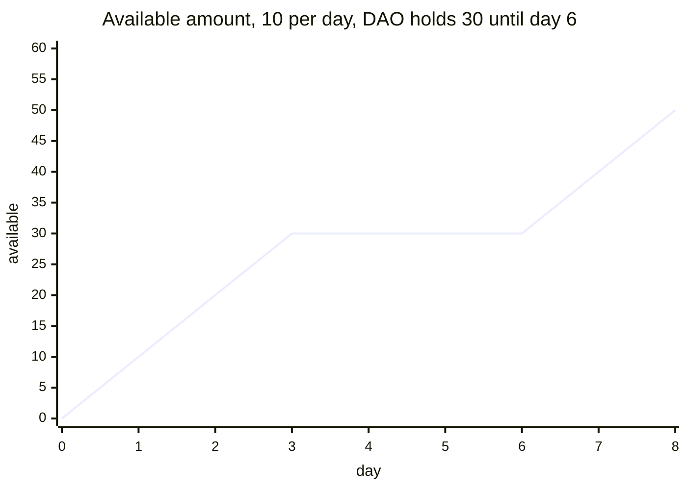
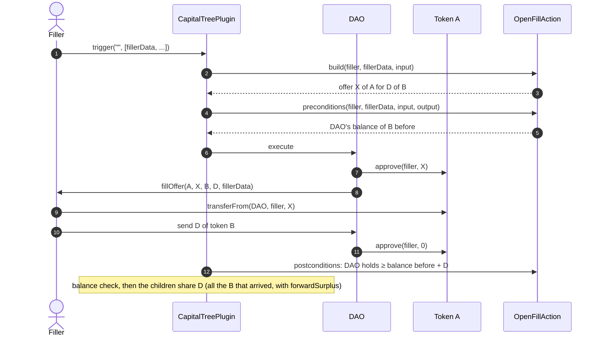

# Components

What each component does, what it checks and its caveats. The [README](../README.md#components)
covers how budgets, actions and splitters fit together.

- **Budgets**: [`StreamBudget`](#streambudget), [`BalanceBudget`](#balancebudget), [`MerkleClaimBudget`](#merkleclaimbudget)
- **Action**: [`OpenFillAction`](#openfillaction)
- **Leaves**: [`TransferAction`](#transferaction), [`TransferToBeneficiaryAction`](#transfertobeneficiaryaction), [`BurnAction`](#burnaction), [`KeepAction`](#keepaction), [`VaultDonateAction`](#vaultdonateaction)
- **Splitter**: [`WeightSplitter`](#weightsplitter)

## StreamBudget

Budget · [`src/budgets/StreamBudget.sol`](../src/budgets/StreamBudget.sol) · settings in
[`metadata/components/StreamBudget.json`](../metadata/components/StreamBudget.json)

A stream that never jumps, built for Dutch auctions where a jump in the offer would be taken by
a filler in the same block. It pays from the DAO's own balance; its commit restarts it from zero.

```
available = min(baseAmount + rate × (now − baseTimestamp), lastSeenBalance, daoBalance, maxBudget)
```

The amount is capped at `lastSeenBalance`, the DAO balance seen at the last checkpoint or
`sync()`, and a deposit doesn't move that until someone syncs. While the DAO is short, the amount
stops growing instead of building up a backlog, and after a deposit and a `sync()` it resumes from
where it stopped.

The chart streams 10 per day from a DAO holding 30, with a deposit of 100 and a `sync()` on day 6.
The amount stops at 30 while the DAO is short and resumes from 30 after the sync.



### Calls

| Call                                                    | Who                          | Effect                                                                                                                                  |
| ------------------------------------------------------- | ---------------------------- | --------------------------------------------------------------------------------------------------------------------------------------- |
| `sync()`                                                | anyone                       | Carries the current amount forward and records the DAO balance. Never raises the amount.                                                |
| `writeCheckpoint()`                                     | `CHECKPOINT_PERMISSION_ID`   | Restarts from zero. The first call, in the install proposal, starts the stream. The plugin runs it through the DAO after every trigger. |
| `setAmountPerEpoch`, `setMaxBudget`, `setEpochInterval` | `SET_SETTINGS_PERMISSION_ID` | Sync first, so time already elapsed keeps the old values. `amountPerEpoch` is at most `type(uint128).max`.                              |

After a deposit the amount stays frozen until someone calls `sync()`: run a keeper, or add a
`sync()` action wherever revenue enters the DAO.

### Start

Nothing accrues until the first checkpoint, so the stream doesn't grow while the installation is
voted on. The install proposal starts it with `writeCheckpoint()` right after applying the
installation. A proposal without that action installs a flow that pays nothing until a later
checkpoint, never one with a backlog.

### Pause

Pausing the plugin doesn't stop the stream's clock. On unpause, what accrued while paused is
available at once, up to the cap: in an auction, a filler takes it at the worst price. To resume
from zero, unpause and call `writeCheckpoint()` in the same DAO proposal (the DAO holds CHECKPOINT,
and can grant itself PAUSE).

### Outflows by another path

Only a `sync()` records a fall in the DAO balance. If another proposal or flow moves the token out
and no sync follows, the curve keeps growing behind the live balance, and when funds come back the
amount jumps to what accrued meanwhile, bounded by the balance seen at the last sync and by the
cap. In an auction, a filler takes that jump at the worst price; an uncapped stream pays it at
once. A sync when the funds come back doesn't undo it, so **every proposal that moves the stream's
token out of the DAO must end with a `sync()` action.**

The reverse is safe for the DAO: a sync while the balance is briefly low restarts the curve lower,
which anyone can time to slow the stream but never to speed it up.

## BalanceBudget

Budget · [`src/budgets/BalanceBudget.sol`](../src/budgets/BalanceBudget.sol) · settings in
[`metadata/components/BalanceBudget.json`](../metadata/components/BalanceBudget.json)

The DAO's whole balance of a token, with nothing to commit. The root receives
all of it, so the tree decides where every token goes.

## MerkleClaimBudget

Budget · [`src/budgets/MerkleClaimBudget.sol`](../src/budgets/MerkleClaimBudget.sol) · settings in
[`metadata/components/MerkleClaimBudget.json`](../metadata/components/MerkleClaimBudget.json)

Cumulative Merkle distribution. Each leaf is `(account, cumulative amount)`, in OpenZeppelin's
StandardMerkleTree format, and an account can claim `cumulative − claimed` at any time. A new root
raises the cumulative amounts for the next round.

- **Budget data**: `abi.encode(account, cumulative, proof)`. Only the account itself can claim,
  and it picks where the payout goes in the data of the
  [`TransferToBeneficiaryAction`](#transfertobeneficiaryaction) node.
- **Available**: what the account is owed, so the tree can split it, swap it or take a fee before a
  `TransferToBeneficiaryAction` pays it out.
- **Records** the claim with `recordClaim` when the budget commits, after the whole tree ran, so it
  rolls back with the flow. The budget requires `RECORD_CLAIM_PERMISSION_ID` for the DAO, which the
  setup grants.
- **Settings**: `setRoot` (`SET_SETTINGS_PERMISSION_ID`). Whoever holds it can direct payouts up to the
  DAO's balance of the token.
- **One flow per instance**: a second flow on the same budget could pay a claim again from a node's
  callback before the first one records it.

One claim per trigger.

## OpenFillAction

Action · [`src/actions/OpenFillAction.sol`](../src/actions/OpenFillAction.sol) · settings in
[`metadata/components/OpenFillAction.json`](../metadata/components/OpenFillAction.json)

A take-it-or-leave-it swap priced as a Dutch auction. It offers its whole input of token A, and
the DAO demands a flat `demandPerFill` of token B for it. Fed by a stream that grows from zero, the
price obtained, `demandPerFill / offered`, worsens as the offer grows. The action has no cap of its
own: the stream's `maxBudget`, times the node's share of it, is the most it can offer, so it sets
the worst price. `script/Recipes.sol` refuses an OpenFill recipe whose stream has no cap. Whoever
finds the trade worth it first calls `trigger()` and fills it.

- **Depends on** its budget, which must be a [`StreamBudget`](#streambudget): the action restarts
  it whenever its demand changes.
- **Moves**: offers its whole input of A and outputs `demandPerFill` of B to its children.
  On a node marked `forwardSurplus`, the children get all the B the filler sent instead.
- **Placement**: anywhere. Below a branch, its input is its share of the budget (see "Grants and
  an auction" in the [README](../README.md#example-flows)); below an action, whatever that action
  passes on. Every node of the flow then waits for a fill, and changing the demand restarts the
  whole budget, not just the auction's share.
- **Checks**: the DAO received at least `demandPerFill` of B, or the whole trigger reverts.
- **Settings**: `setDemandPerFill` (`SET_SETTINGS_PERMISSION_ID`) restarts the auction, so the action
  requires `CHECKPOINT_PERMISSION_ID` on its budget, which the setup grants. The stream's
  `setMaxBudget` moves the worst price: raising the cap lowers it.



### Fillers

The filler is the contract that calls `trigger()`, and it implements `IFiller.fillOffer`. The
trigger takes empty budget data and a per-node `bytes[]`.

`GenericFillSolver` ([`src/solvers/GenericFillSolver.sol`](../src/solvers/GenericFillSolver.sol))
is a minimal filler, deployed per plugin. Its `authorized` operator calls `trigger(nodeData)`,
which triggers the plugin with empty budget data. When the DAO calls `fillOffer`, the solver runs
the batch of calls encoded as `Action[]` in its node data: typically pull the offered A from the
DAO, swap it for B through a router, send `demandPerFill` of B to the DAO, and `sweep` what's left
to the operator. Only the DAO can call `fillOffer`, and only the operator (or the solver itself,
inside a batch) can call `sweep`. It checks nothing else, and it sends no ether with its calls; a
solver that wants more guarantees implements its own.

`test/solvers/OpenFillLocal.t.sol` runs it offline against a local router
(`script/open-fill/DeployLocal.s.sol`). `just fork-tests` runs `test/solvers/OpenFillFork.t.sol`
on a mainnet fork against live aggregator quotes, with the keys listed in
`script/open-fill/vars.yaml`; `just fork-tests false` skips the live quote APIs. See
[`script/open-fill/README.md`](../script/open-fill/README.md) for the scripts.

## TransferAction

Leaf · [`src/actions/TransferAction.sol`](../src/actions/TransferAction.sol) · settings in
[`metadata/components/TransferAction.json`](../metadata/components/TransferAction.json)

Sends its whole input to a fixed recipient and outputs nothing.

- **Check**: the recipient's balance rose by the amount. This catches tokens that return `false`
  instead of reverting. Fee-on-transfer and rebasing tokens fail it by design.
- **Recipient**: set at initialization, with no setter. Changing it means a new flow (`setFlow`).

## TransferToBeneficiaryAction

Leaf · [`src/actions/TransferToBeneficiaryAction.sol`](../src/actions/TransferToBeneficiaryAction.sol) · settings in
[`metadata/components/TransferToBeneficiaryAction.json`](../metadata/components/TransferToBeneficiaryAction.json)

Sends its whole input to the address in its node data, picked by the caller, and outputs nothing.

- **Check**: the beneficiary's balance rose by the amount. This catches tokens that return `false`
  instead of reverting. Fee-on-transfer and rebasing tokens fail it by design.
- **Who picks the address**: the caller. Use it only where the caller may direct the funds: under a
  [`MerkleClaimBudget`](#merkleclaimbudget) (only the claiming account can trigger) or on a flow
  whose trigger is restricted. On a flow anyone can trigger with a stream or balance budget, anyone
  could pay themselves.

## BurnAction

Leaf · [`src/actions/BurnAction.sol`](../src/actions/BurnAction.sol) · settings in
[`metadata/components/BurnAction.json`](../metadata/components/BurnAction.json)

Calls `burn(amount)` on its input token, which must be an `ERC20Burnable`, and outputs nothing.

- **Check**: the DAO's balance dropped by the amount.

## KeepAction

Leaf · [`src/actions/KeepAction.sol`](../src/actions/KeepAction.sol) · settings in
[`metadata/components/KeepAction.json`](../metadata/components/KeepAction.json)

Does nothing: its input stays in the DAO. Every branch must end in a leaf, so keeping funds is an
explicit choice in the tree.

## VaultDonateAction

Leaf · [`src/actions/VaultDonateAction.sol`](../src/actions/VaultDonateAction.sol) · settings in
[`metadata/components/VaultDonateAction.json`](../metadata/components/VaultDonateAction.json)

Donates its whole input to a fixed vault and outputs nothing. `donate()` raises the vault's assets
without minting shares, so the vault's existing holders get the value; the DAO gets no position.

- **Check**: the input token is the vault's asset, and the vault's total assets rose by at least
  the amount.
- **Trust**: the vault is trusted, and only vaults that count a donation in their assets
  immediately are supported.

[`docs/avkat-buyback.md`](avkat-buyback.md) walks through a buyback that donates to avKAT.

## WeightSplitter

Splitter · [`src/splitters/WeightSplitter.sol`](../src/splitters/WeightSplitter.sol) · settings in
[`metadata/components/WeightSplitter.json`](../metadata/components/WeightSplitter.json)

Splits a branch's output by fixed weights: one weight per child, in the node's child order, each
non-zero, summing to 1,000,000.

- **Rounding**: the remainder goes to the largest weight (the first one on a tie). A child whose
  share rounds down to 0 reverts the trigger, unless it's marked `skipWhenEmpty`.
- **Child count**: `childCount()` is the number of weights, so weights for another number of
  children fail `setFlow` (`InvalidSplitter`).
- **Settings**: `setWeights` (`SET_SETTINGS_PERMISSION_ID`, which the recipes grant to the manager)
  keeps their number (`WeightCountChanged`): the children only change with `setFlow`.
